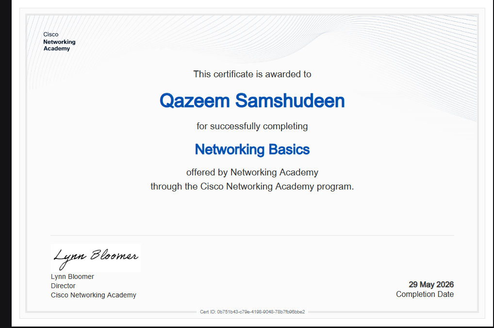
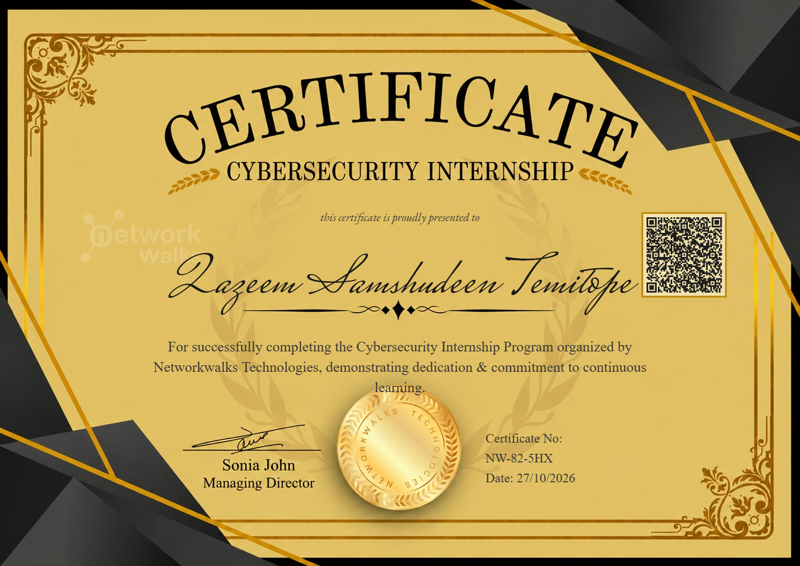
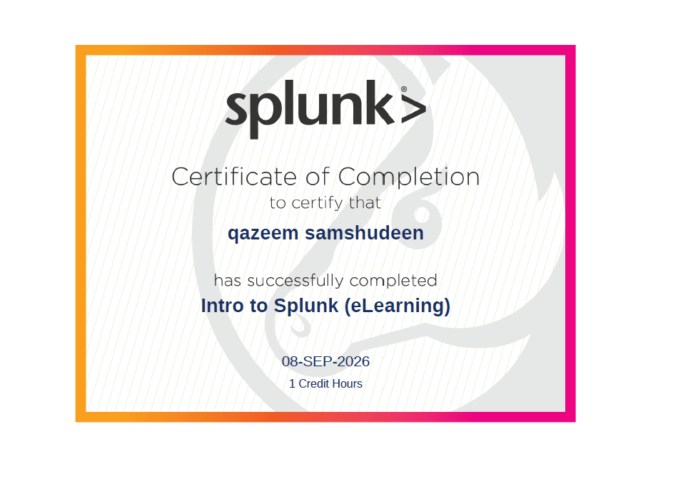

# QAZEEM SAMSUDEEN TEMITOPE
### **Junior Cybersecurity Analyst | SOC Analyst Tier 1 |penetration testing| Cloud Security & Identity Governance**
**Defending Enterprise Infrastructure • Active Directory Hardening • SIEM Detection Engineering**

---

## 🛡️ About Me

I am an investigative, results-driven **Cybersecurity Analyst & SOC Tier 1 Practitioner** with hands-on experience spanning Security Operations (SOC), Active Directory administration, cloud identity security (AWS IAM), and vulnerability assessment.

Holding a **B.Sc. in Criminology and Security Studies** from the **University of Ilorin (UNILORIN)**, I combine investigative methodologies with deep technical tradecraft—ingesting multi-source telemetry into Splunk SIEM, hunting credential-based attacks (MITRE ATT&CK T1110), implementing Least Privilege (PoLP) on Windows Server architectures, and simulating cloud privilege escalation scenarios.

- 🔭 **Current Focus:** SOC Tier 1 Monitoring, Active Directory Pentesting, SIEM Detection Engineering, and Cloud Security.
- 💼 **Experience:** Cybersecurity Intern at **Bincom Dev Center** | Information Security Intern at **UNILORIN Cybersecurity Unit**.
- 📜 **Certifications:** Cisco IT Support Specialist, Cisco Networking Basics, Cisco Intro to Cybersecurity, Splunk Core Fundamentals.
- 🎯 **Career Goal:** Safeguarding enterprise infrastructure and critical assets as a SOC Analyst / Cloud Security Analyst.

---

## 🚀 Featured Security Projects

### 1. Enterprise Active Directory Architecture & Least-Privilege Hardening
`WINDOWS SERVER 2022` `ACTIVE DIRECTORY` `AGDLP MODEL` `GROUP POLICY` `PoLP`

An enterprise directory service deployment on Windows Server 2022 (`BlaqqSec-lab.local`) focused on establishing role-based access control, helpdesk delegation, and audit logging without granting excessive administrative privileges.

- **Hierarchical OU Architecture:** Structured organizational units separating administrative tiers, staff workstations, and service accounts.
- **AGDLP Role-Based Access Control:** Implemented Account → Global Group → Domain Local Group → Permission hierarchy to prevent privilege creep.
- **Helpdesk Rights Delegation:** Delegated password reset and account unlock privileges to Tier-1 Helpdesk without Domain Admin escalation.
- **GPO Security Hardening:** Enforced domain-wide USB storage device blocking and configured Advanced Security Audit Policies (Event IDs 4624, 4625, 4688).

---

### 2. Splunk SIEM Threat Monitoring & T1110 Incident Attribution
`SIEM` `SPLUNK ENTERPRISE` `SPL HUNTING` `MITRE ATT&CK T1110` `INCIDENT RESPONSE`

Ingested multi-source telemetry from Linux auth logs and Windows event logs into Splunk Enterprise to detect and attribute multi-threaded brute-force attacks in real time.

- **Log Ingestion & Parsing:** Configured Splunk forwarders and indexes to capture authentication attempts, SSH sessions, and failed logon bursts.
- **Custom SPL Threat Hunting:** Authored targeted SPL queries calculating authentication velocity, threshold anomalies, and failed logon sequences (Event ID 4625).
- **Incident Attribution:** Attributed 100% of brute-force bursts to adversary IP addresses and automated containment triggers via Fail2ban.
- **SOC Executive Dashboard:** Designed dark-mode real-time visual dashboards tracking top attacked users, geographical origins, and timeline spikes.

---

### 3. Cloud Security: AWS IAM Privilege Escalation & Least-Privilege Remediation
`AWS CLOUD` `IAM` `PRIVILEGE ESCALATION` `CLOUDGOAT` `LEAST PRIVILEGE`

Simulated the industry-standard Rhino Security Labs **CloudGoat `iam__privesc_by_attachment`** attack lifecycle inside an isolated AWS cloud sandbox engine and engineered production-grade remediation guardrails.

- **Vulnerability Reproduction:** Provisioned low-privilege user `intern-qazeem` with an overly permissive `iam:AttachUserPolicy` wildcard permission (`Resource: *`).
- **Exploit Execution:** Abused attachment rights to bind `AdministratorAccess` (`*:*`) to the unprivileged identity, achieving root-level account takeover.
- **Least-Privilege Remediation:** Contained the compromise, revoked admin rights, and authored a hardened policy with strict read-only access.
- **Explicit Deny Guardrails:** Engineered an `ExplicitDeny` policy on all `iam:Attach*` and `iam:Put*` actions, permanently neutralizing escalation vectors.

---

### 4. Web Application Security & ModSecurity WAF Defense
`APACHE WAF` `MODSECURITY` `OWASP CRS` `VIRTUAL PATCHING` `WEB DEFENSE`

Deployed an enterprise reverse-proxy Web Application Firewall (WAF) using Apache and the OWASP Core Rule Set (CRS) to protect web applications against OWASP Top 10 exploits.

- **Rule Deployment:** Deployed 800+ OWASP CRS detection rules to intercept and inspect HTTP request payloads.
- **Virtual Patching:** Authored custom regular-expression rules to virtually patch known SQL Injection (SQLi) and Cross-Site Scripting (XSS) attack vectors with HTTP 403 Forbidden.
- **Evasion Testing:** Simulated obfuscated payloads to validate WAF inspection sensitivity and false-positive rates.

---

## 🛠️ Technical Skills & Security Toolkit

### Security Operations & Threat Monitoring

### Identity & Access Governance (IAM)

-005A9E?style=for-the-badge)

-107C41?style=for-the-badge)

### Vulnerability Assessment & Penetration Testing

### Operating Systems & Virtualization

---

## 📜 Verified Certifications & Badges

| Certification / Badge | Issuing Organization | Verification Link |
| :--- | :--- | :--- |
| **IT Support Specialist** | Cisco Networking Academy | [Verify on Credly ↗](https://www.credly.com/badges/c54f5738-0c67-4e7c-8ca7-98c3bde4d51e) |
| **Networking Basics** | Cisco Networking Academy | [Verify on Credly ↗](https://www.credly.com/badges/38c54253-3e3f-43de-8eed-39aca261336d) |
| **Introduction to Cybersecurity** | Cisco Networking Academy | [Verify on Credly ↗](https://www.credly.com/badges/fd0065d5-d52e-450c-bd75-819c54f1ed65) |
| **Splunk Core Fundamentals / Certified Beginner** | Splunk Inc. | Verified Certificate |
| **Black-Box Penetration Testing** | NetworkWalks Academy | Verified Participation Certificate |
| **ByteMe CTF Certified Competitor** | ByteMe Cyber Defense | Certified Competitor (2026) |

**bytemecert**

**cisco-IT customer-cert**

**cisco-cybersecurity-beginner**

**networking-basics**

**networkwalks**

**splunk-cert**

 
---

## 🎓 Education & Background

- **B.Sc. in Criminology and Security Studies**  
  *University of Ilorin (UNILORIN), Ilorin, Nigeria* | **2022 – 2026**  
  *Focus:* Cyber Criminology, Organizational Risk Management, Security Intelligence, Compliance Governance (NDPA/NDPR/HIPAA).

---

### 🤝 Let's Connect
**Open to Junior Cybersecurity Analyst, SOC Analyst Tier 1, and IT Security Opportunities.**

[LinkedIn](https://linkedin.com) • [Email](mailto:qazeemsamshudeen@gmail.com) • [WhatsApp](https://wa.me/2348130406501)

