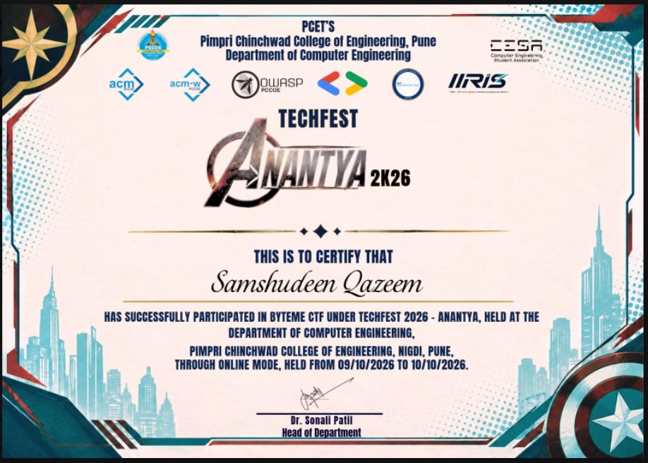
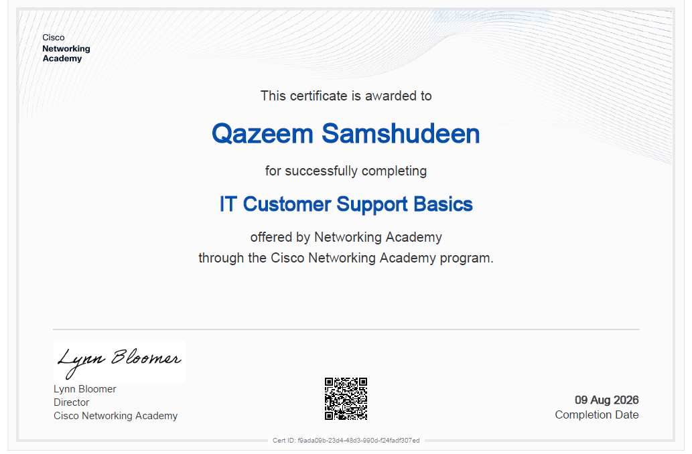
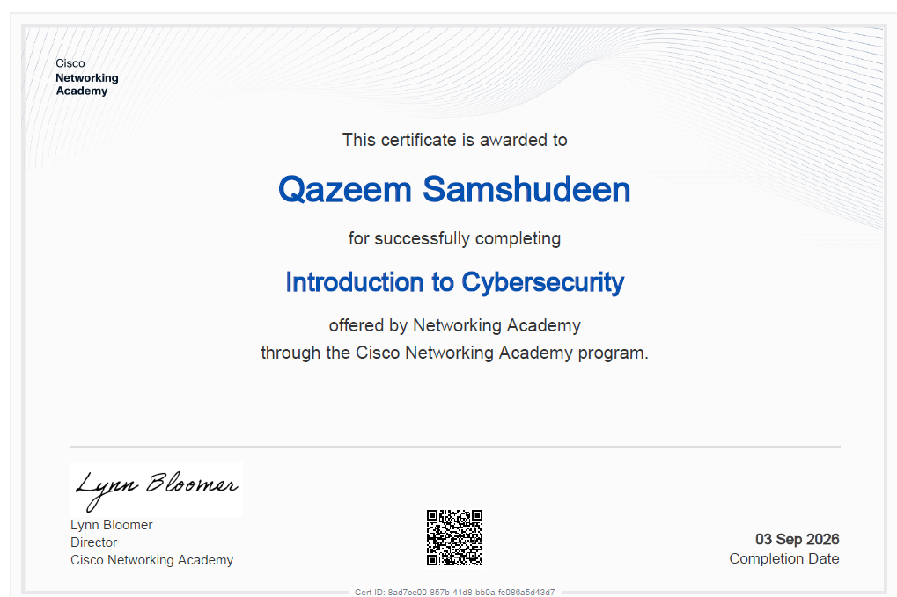

# QAZEEM SAMSUDEEN TEMITOPE
### **Cybersecurity Analyst | SOC Analyst Tier 1 | Application & Systems Defense**
**Web Defense & ModSecurity WAF • Splunk SIEM Threat Hunting • Active Directory & Cloud IAM**

---

## 🛡️ About Me

I am a security practitioner and final-year **Criminology and Security Studies** student at the **University of Ilorin (UNILORIN)**, bridging digital risk governance with practical, hands-on security tradecraft. 

My work focuses on defending applications and enterprise environments: configuring **Web Application Firewalls (ModSecurity WAF)** with OWASP Core Rulesets, investigating credential-stuffing and brute-force attacks in **Splunk SIEM**, auditing permissions and implementing the **Principle of Least Privilege (PoLP)** in Windows Server and AWS Cloud IAM, and conducting pre-launch vulnerability assessments.

- 🔭 **Current Focus:** Application Security, SOC Tier-1 Threat Monitoring, Active Directory Hardening & Cloud Identity Governance.
- 💼 **Experience:** Cybersecurity & IT Infrastructure Intern at **Bincom Dev Center** (November 2026 – Present).
- 📜 **Cisco Certified:** Introduction to Cybersecurity, Networking Basics, and IT Support Specialist.
- 🎯 **Career Objective:** Joining an engineering or security operations team as a **Cybersecurity Analyst / SOC Tier 1 / IT Security Specialist**.

---

## 🚀 Practical Security Projects & Tools Used

### 1. Web Application Defense & Apache ModSecurity WAF Deployment
> **Primary Tools Used:** `Apache HTTP Server` • `ModSecurity 3.x` • `OWASP Core Rule Set (CRS)` • `Burp Suite` • `Nikto` • `Curl / Bash CLI`

Implemented a hardened reverse-proxy Web Application Firewall (WAF) using Apache to defend web applications against OWASP Top 10 vulnerabilities and protect backend databases.
- **WAF Rule Deployment:** Configured over 800+ OWASP Core Rule Set (CRS) detection rules to inspect incoming HTTP/HTTPS traffic.
- **Custom Virtual Patching:** Engineered custom regex-based virtual patch rules to intercept Cross-Site Scripting (XSS) and SQL Injection (SQLi) attacks, returning `403 Forbidden` responses prior to backend execution.
- **Security Validation:** Conducted pre-launch scans using Burp Suite and Nikto to verify rule efficacy and eliminate false positives.

---

### 2. Splunk SIEM Threat Monitoring & T1110 Incident Attribution
> **Primary Tools Used:** `Splunk Enterprise` • `SPL (Search Processing Language)` • `Ubuntu Linux` • `Windows Event Logs` • `Wireshark`

Built an end-to-end security monitoring pipeline ingesting multi-source authentication telemetry to detect and investigate brute-force intrusions in real time.
- **Telemetry Ingestion:** Configured universal forwarders to ingest Windows Event Logs (Event IDs 4624, 4625) and Linux `auth.log` files into Splunk indexes.
- **Detection Engineering:** Developed custom SPL search queries tracking authentication attempt velocity to catch multi-threaded brute-force attacks (**MITRE ATT&CK T1110**).
- **Network Traffic Inspection:** Inspected raw packet captures via Wireshark to verify authentication headers and correlate adversary source IP addresses.
- **SOC Dashboard:** Designed real-time visual dashboards summarizing failed login surges, geographic sources, and targeted usernames.

---

### 3. AWS Cloud IAM Privilege Escalation & Least-Privilege Remediation
> **Primary Tools Used:** `AWS Management Console` • `AWS CLI` • `CloudGoat Sandbox` • `IAM JSON Policies` • `Least Privilege (PoLP)`

Replicated the Rhino Security Labs **CloudGoat `iam__privesc_by_attachment`** attack vector within an isolated AWS sandbox and engineered permanent policy guardrails.
- **Attack Simulation:** Exploited an over-permissive `iam:AttachUserPolicy` permission on a test user (`intern-qazeem`) to attach `AdministratorAccess` and gain root-level account compromise.
- **Hardened Least-Privilege Policy:** Revoked excessive administrative rights and authored a minimal read-only JSON policy strictly mapped to job requirements.
- **Explicit Deny Guardrail:** Enforced an `ExplicitDeny` policy block on `iam:Attach*` and `iam:Put*` API calls to permanently prevent unauthorized privilege escalation.

---

### 4. Windows Server 2022 Active Directory & Group Policy Hardening
> **Primary Tools Used:** `Windows Server 2022` • `Active Directory Domain Services (AD DS)` • `Group Policy Management (GPMC)` • `Oracle VirtualBox`

Engineered a dedicated directory services lab (`BlaqqSec-lab.local`) to practice identity management, administrative tiering, and endpoint security policies.
- **Hierarchical OU Design:** Built departmental Organizational Units (OUs) separating administrative personnel, standard staff, and service accounts.
- **RBAC & AGDLP Model:** Implemented Account → Global Group → Domain Local Group → Permission hierarchy to prevent privilege creep.
- **Group Policy Hardening:** Deployed domain-level GPOs disabling unauthorized USB mass storage devices and enforcing password complexity requirements.
- **Privilege Delegation:** Practiced Tier-1 Helpdesk delegation (password resets, account unlock) without granting Domain Admin rights.

---

### 5. Server Patch Management & Vulnerability Remediation
> **Primary Tools Used:** `Apache Web Server` • `Linux CLI (Ubuntu/Debian)` • `CVE Vulnerability Reports` • `Technical Runbooks`

Hands-on operational security tasks conducted as part of the Bincom Dev Center structured internship.
- **Vulnerability Assessment:** Reviewed application test environments for outdated software packages, unpatched web libraries, and insecure default configurations.
- **Patch Management:** Reviewed update notifications and deployed security patches to Apache web servers to remediate known CVE exploits.
- **Technical Documentation:** Wrote step-by-step developer runbooks documenting vulnerability reproduction and patch verification procedures.

---

## 🛠️ Technical Skills Mapped to Tools

| Domain | Tools & Technologies | Context / Project Applied |
| :--- | :--- | :--- |
| **Web & App Security** | Apache HTTP Server, ModSecurity WAF, OWASP CRS | Reverse-proxy WAF deployment, virtual patching (SQLi, XSS) |
| **Vulnerability Assessment** | Burp Suite Community, Nikto, Nmap | Pre-deployment web testing, port discovery & service auditing |
| **SIEM & Log Analysis** | Splunk Enterprise, SPL Queries, Wireshark | T1110 brute-force detection, auth log auditing, packet inspection |
| **Cloud Security (IAM)** | AWS Management Console, AWS CLI, JSON IAM Policies | CloudGoat privesc testing, least-privilege guardrails |
| **Directory Services & OS** | Windows Server 2022, Active Directory, GPO | OU hierarchy, USB blocking policy, helpdesk rights delegation |
| **Virtualization & Systems** | Oracle VirtualBox, Ubuntu Linux, Windows 10/11 | Isolated multi-VM lab environments, bash CLI administration |
| **Compliance & Frameworks** | NDPA (Nigeria Data Protection Act), MITRE ATT&CK | Data privacy alignment, adversary technique mapping |

---

## 📜 Verified Certifications & Credentials

| Credential | Issuer | Verification |
| :--- | :--- | :--- |
| **IT Support Specialist** | Cisco Networking Academy | [Verify on Credly ↗](https://www.credly.com/badges/c54f5738-0c67-4e7c-8ca7-98c3bde4d51e) |
| **Networking Basics** | Cisco Networking Academy | [Verify on Credly ↗](https://www.credly.com/badges/38c54253-3e3f-43de-8eed-39aca261336d) |
| **Introduction to Cybersecurity** | Cisco Networking Academy | [Verify on Credly ↗](https://www.credly.com/badges/fd0065d5-d52e-450c-bd75-819c54f1ed65) |
| **Splunk Core Certified Beginner** | Splunk Inc. | Verified Training Completion |
| **ByteMe CTF Competitor** | ByteMe Cyber Defense | Certified Competitor (2026) |

---

## 🎓 Education

**Bachelor of Science (B.Sc.) in Criminology and Security Studies**  
*University of Ilorin (UNILORIN), Ilorin, Kwara State, Nigeria*  
Expected Completion: 2026 (Final Year)  
- **Relevant Coursework:** Cyber Criminology, Risk Governance, Security Intelligence, Nigeria Data Protection Act (NDPA) Compliance.

---

### 📬 Connect With Me

Looking for an eager, hands-on **Junior Cybersecurity Analyst**, **SOC Analyst Tier 1**, or **IT Security Specialist**? Let's connect!

📞 **WhatsApp / Phone:** [+234 813 040 6501](https://wa.me/2348130406501) • `08130406501`  
✉ **Email:** [qazeemsamshudeen@gmail.com](mailto:qazeemsamshudeen@gmail.com)  
🔗 **LinkedIn:** [linkedin.com/in/qazeem-samshudeen-94b314398](https://www.linkedin.com/in/qazeem-samshudeen-94b314398/)  
💻 **GitHub:** [github.com/qazeemsamshudeen-web](https://github.com/qazeemsamshudeen-web)

**bytemecert**

**cisco-IT customer-cert**

**cisco-cybersecurity-beginner**

**networking-basics**

**networkwalks**

**splunk-cert**

 
---

## 🎓 Education & Background

- **B.Sc. in Criminology and Security Studies**  
  **University of Ilorin**
  *Focus:* Cyber Criminology, Organizational Risk Management, Security Intelligence.

---

### 🤝 Let's Connect
**Open to Junior Cybersecurity Analyst, SOC Analyst Tier 1, and IT Security Opportunities.**

[LinkedIn](https://linkedin.com) • [Email](mailto:qazeemsamshudeen@gmail.com) • [WhatsApp](https://wa.me/2348130406501)

